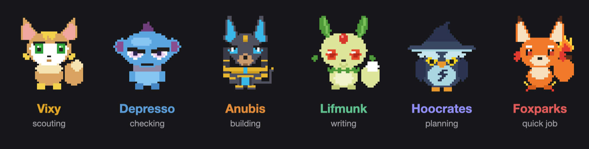
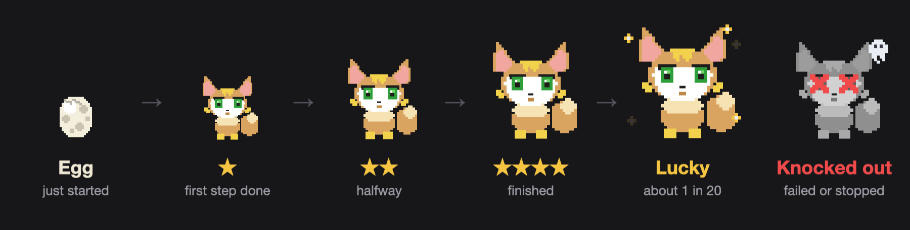
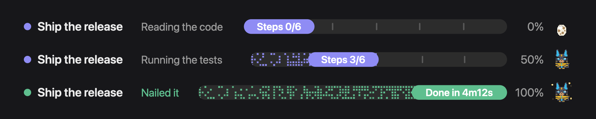

# Spotter Pals

**Your Claude Code helpers, as pixel Pals that hatch, grow and get knocked out.**

Spotter is a mod for Claude Code. It watches the work and counts the steps: a progress bar for the
job, a Pal for every helper agent, and a headline for every reply. It works in the desktop app and
in the terminal.

## Install

    claude plugin install spotter --marketplace swhite1122/spotter-pals

Start a new session and it is on. Nothing to set up.

Needs Claude Code 2.1.287 or later (2.1.286 in the desktop app). Built and tested on 2.1.296.

## Every helper gets a Pal

When Claude sends a helper agent off to do something, Spotter gives it a Pal picked by the job:

| Pal | Job | Shows up when a helper is… |
| --- | --- | --- |
| **Vixy** | scouting | searching, reading, exploring the code |
| **Depresso** | checking | reviewing, testing, auditing |
| **Anubis** | building | writing code, fixing, wiring things up |
| **Lifmunk** | writing | drafting docs, notes and design |
| **Hoocrates** | planning | planning, scoping, architecture |
| **Foxparks** | quick job | renames, tidying, anything fast |

## They grow while the work gets done

- **Egg.** Every helper starts as one. You find out who is inside when it does its first step.
- **Stars.** One star once it is moving, two at the halfway mark, four when it finishes.
- **Lucky.** About one helper in twenty hatches a Lucky Pal: bigger, with gold sparkles. You only
  find out when it finishes.
- **Knocked out.** A helper that fails or gets stopped goes grey, with crossed eyes and a little
  ghost. You will not miss it.

## A progress bar that knows the steps

On any job of three or more steps Claude reports its plan, and Spotter draws it above the prompt:
the job, the step under way, how many are left, and how long it took at the end. Helpers can
report their own steps too, and each one gets its own count.

## The rest of the panel

- **Session box.** How full the context is, your plan limits, and how long the prompt cache stays
  warm, so you know when a message will be cheap and when it will re-read everything.
- **Last reply.** One line for every reply: how long it took, what it cost, how many files changed,
  and a streak of clean ones. "3 Pals went in. Zero errors came out."
- **Details.** Click a helper (or press its number) to see what it did and what it reported.

## In the terminal

No side panel needed. Helpers show up as lines above the prompt while they run, then clear:

    ● Ship the release   Running the tests  ████████░░░░░░░░  Steps 3/6  50%  🐺  🐾×3  ✕
    ◐ 🦊 ★★    Map the call sites      ▰▰▰▰▱▱ 3/4 · Reading hooks    Sonnet 5.5  0:42
    ◐ 🐨 ★     Review the parser       ▰▰▱▱▱▱ 1/4 · Running tests    Sonnet 5.5  0:31
    ◐ 🥚       Draft the release note  ▱▱▱▱▱▱ 0/3 · Starting         Haiku 5.5   0:04

Each Pal has an emoji there: 🥚 for the egg, ✨ for Lucky, 💀 for knocked out. `/spotter` opens the
full panel when you want it.

## Commands and settings

    /spotter          open the panel
    /spotter close    close it
    /spotter reset    clear its helpers and counters

Two settings, in `/config`: `openOnStart` (open the panel by itself in the desktop app) and
`motion` (set it to `off` to keep the Pals still).

## What it touches

- It watches tool calls, helper agents, and the session's own cost, context and limit readings.
- It keeps short notes in memory for the session only, with passwords and keys masked.
- It makes no network calls, reads and writes no files, and runs no programs.
- It gives Claude one small tool, `progress`, to report steps. That is how the bar gets its
  numbers, and it costs a few tokens per update.

## Credit

Spotter began as a fork of [Flightdeck](https://github.com/scasella/claude-flightdeck) by Stephen
Casella (MIT, see `LICENSE`). The progress bar's look is adapted from
[savvy-progress](https://github.com/JohnnyVizz/claude-kit) by johnnyvizz (MIT).

The Pals are unofficial fan art: pixel drawings made for this mod of creatures from Palworld.
Palworld and its Pals belong to Pocketpair, Inc. Spotter is not affiliated with or endorsed by
Pocketpair.

Made by [Steady Matter](https://github.com/Steady-Matter). MIT licence.
